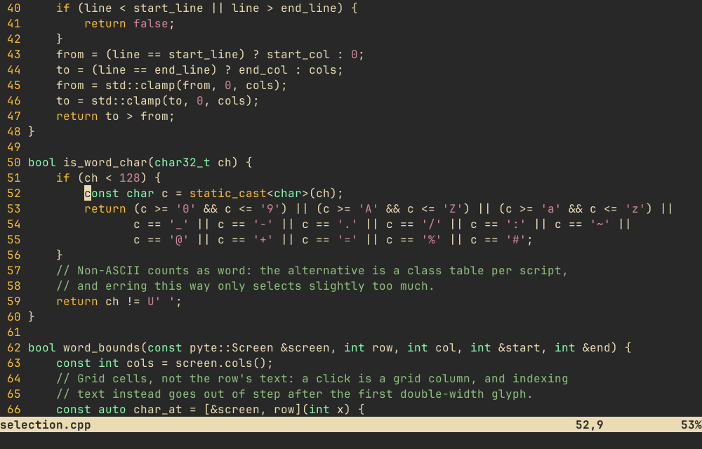
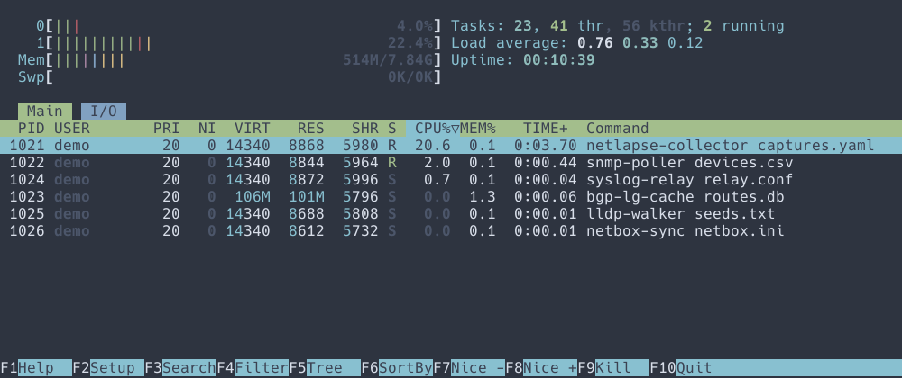
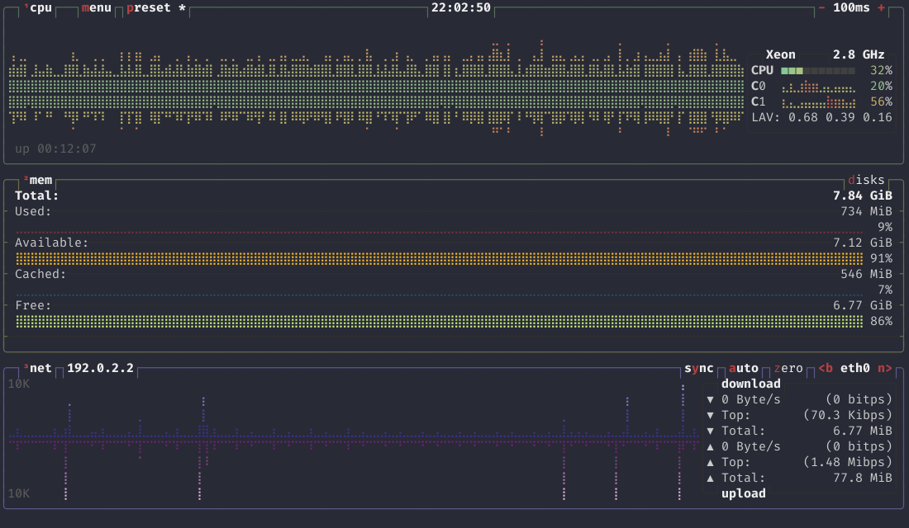
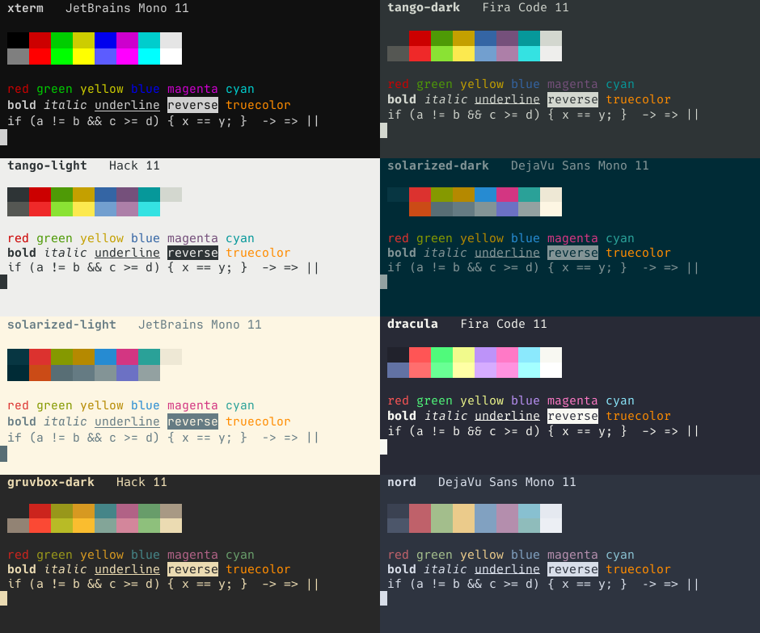

# gtkpyte

A GTK 4 terminal widget, and a small terminal app built on it, for Linux.

The emulation core is **pyte C++**, a headless C++17 terminal emulator shared
with [anytermqt](https://github.com/scottpeterman/anytermqt) (qtpyte, the Qt
widget under the Omega suite). It is not the Python
[pyte](https://github.com/selectel/pyte) library: it is the author's own port,
by way of his earlier Go port, [gopyte](https://github.com/scottpeterman/pathfinderssh/tree/main/internal/gopyte) (see [Lineage](#lineage)). gtkpyte puts
a native GTK front end on it: a `GtkWidget` subclass with a plain C API,
GObject properties and signals, so it fits the way traditional GTK
applications are put together.



## Screenshots

**htop**, nord scheme, Hack 12:



**btop**, dracula scheme, Fira Code 11. Braille graphs, box drawing and
truecolor on the cell grid:



**All eight built-in schemes**, alternating JetBrains Mono, Fira Code, Hack
and DejaVu Sans Mono. The last line of each shows that programming-font
ligatures are off: `!=`, `>=` and `==` stay two cells wide.



## Features

- **Rendering**: 16, 256 and 24-bit colour; bold, italic, underline, reverse,
  strikethrough; double-width CJK, box drawing and braille on the cell grid.
  Full-screen apps (vim, htop, btop, mc) run on the alternate screen.
- **Scrollback**: 5000 lines by default, through a `GtkScrollable`
  scrollbar, the wheel or touchpad, or Shift+PageUp/PageDown.
- **Selection**: drag, double-click a word (`10.20.30.40/24`, `/etc/hosts`
  and `ge-0/0/1.0` come out whole), triple-click a line, Shift-click to
  extend. Drag past the edge to auto-scroll through history. Selections stay
  attached to their text as output scrolls.
- **Clipboard**: Ctrl+Shift+C / Ctrl+Shift+V / Ctrl+Shift+A. Selecting fills
  the primary selection; middle-click pastes it. Bracketed paste when the
  application asks for it. Large pastes are queued, never truncated.
- **Mouse**: xterm mouse reporting (modes 1000, 1002, 1003; SGR 1006 and
  classic encodings) for vim `mouse=a`, htop, tmux and mc, with Shift held to
  select locally. Alternate-scroll (1007) so the wheel works in less, man
  and a mouse-less vim.
- **Appearance**: any Pango monospace font, with ligatures turned off so
  every character keeps its own cell; eight built-in colour schemes; every
  colour settable through the API or as a property.

## Building

Debian 12 or later, Ubuntu 22.04 or later, or ChromeOS Linux (Crostini). GTK
4.8 and Meson 1.0 are the floor.

```bash
sudo apt install -y build-essential git pkg-config meson ninja-build libgtk-4-dev
```

```bash
git clone https://github.com/scottpeterman/gtkpyte && cd gtkpyte
```

```bash
scripts/build.sh
```

`scripts/build.sh` configures, builds and runs the tests. The first run needs
network access: Meson fetches utf8proc and doctest at pinned tags. Other
options:

| Command | Result |
|---|---|
| `scripts/build.sh --release` | release build in `build-release/` |
| `scripts/build.sh --clean` | wipe the build directory first |
| `scripts/build.sh --no-tests` | skip the tests (doctest is not fetched) |
| `scripts/build.sh --deps` | apt-install the toolchain first |
| `scripts/build.sh --install` | install to `~/.local`, with a launcher entry |
| `scripts/build.sh --prefix /opt/gtkpyte` | install elsewhere |
| `scripts/build.sh --run -- htop` | build, then run a program in gtkpyte |

`scripts/build.sh --release --install` puts gtkpyte in the desktop's
application menu; on a Chromebook it appears under Linux apps.

Plain Meson works too:

```bash
meson setup build && meson compile -C build && meson test -C build
```

## Running

```bash
./build/gtkpyte
./build/gtkpyte --font "DejaVu Sans Mono 13" --scheme solarized-dark
./build/gtkpyte -- htop
./build/gtkpyte --list-schemes
```

With no program, gtkpyte runs `$SHELL`. The window closes when the program
exits.

Schemes: `xterm` (default), `tango-dark`, `tango-light`, `solarized-dark`,
`solarized-light`, `dracula`, `gruvbox-dark`, `nord`.

## Using the widget

The widget owns a screen and nothing else. Bytes go in with
`gtkpyte_terminal_feed()` and come out on the `commit` signal; whatever is on
the other end (a local pty, an SSH channel, a serial port, a recorded
capture) is the caller's. `PtySession` is the ready-made local-pty end.

```c
GtkWidget *term = gtkpyte_terminal_new();
gtkpyte_terminal_set_font(GTKPYTE_TERMINAL(term), "Monospace 12");
gtkpyte_terminal_set_color_scheme(GTKPYTE_TERMINAL(term), "nord");

/* Scrollbar: the terminal is a GtkScrollable. */
GtkWidget *scroller = gtk_scrolled_window_new();
gtk_scrolled_window_set_policy(GTK_SCROLLED_WINDOW(scroller), GTK_POLICY_NEVER, GTK_POLICY_AUTOMATIC);
gtk_scrolled_window_set_child(GTK_SCROLLED_WINDOW(scroller), term);

/* Wire it to your transport. */
g_signal_connect(term, "commit", G_CALLBACK(on_commit), channel);    /* GBytes * to send */
g_signal_connect(term, "resized", G_CALLBACK(on_resized), channel);  /* cols, rows */
/* ... and on data from the transport: */
gtkpyte_terminal_feed(GTKPYTE_TERMINAL(term), buf, len);
```

Or from a `.ui` file, after `g_type_ensure(GTKPYTE_TYPE_TERMINAL)`:

```xml
<object class="GtkpyteTerminal" id="terminal">
  <property name="font">Monospace 12</property>
  <property name="color-scheme">solarized-dark</property>
  <property name="scrollback-lines">10000</property>
  <property name="selection-color">rgba(255,200,0,0.35)</property>
</object>
```

**Properties**: `font`, `scrollback-lines`, `color-scheme`,
`foreground-color`, `background-color`, `cursor-color`, `selection-color`,
plus `GtkScrollable`'s four.

**Signals**: `commit` (bytes to send upstream, including the emulator's own
replies to terminal queries; drop it and some applications hang waiting),
`resized` (send TIOCSWINSZ or an SSH window-change), `selection-changed`.

The full API, with ownership and NULL rules, is commented in
`src/gtkpyte-terminal.h`.

## Layout

```
pyte/            headless emulation core: parser, screen, scrollback; no GTK
  include/pyte/  Cell, RowStore, Screen, Stream
  tests/         doctest suite
  tools/ptdump/  feed a capture, print the resulting screen
src/
  gtkpyte-terminal.{h,cpp}  the widget: rendering, input, selection, scrolling
  keymap.{h,cpp}            GDK keys to terminal byte sequences
  mouse.{h,cpp}             xterm mouse-report encoding
  selection.{h,cpp}         selection model, word boundaries
  palette, schemes          colours
  pty.{h,cpp}               forkpty child process
  ptysession.{h,cpp}        pty <-> widget, with a write queue
  main.cpp                  the gtkpyte app
tests/           doctest suite for the GTK-free parts of src/
scripts/build.sh
```

Keymap, mouse encoding, selection, schemes and the pty have no GTK
dependency in their logic and are tested directly. The widget is the thin
layer that turns GTK events into calls on them.

## Lineage

| Step | Language | What it is |
|---|---|---|
| [pyte](https://github.com/selectel/pyte) | Python | The original terminal emulator library, by George Shuklin, Sergei Lebedev and contributors. The design all the ports follow. |
| [gopyte](https://github.com/scottpeterman/pathfinderssh/tree/main/internal/gopyte) | Go | Scott Peterman's first port: Python pyte to Go. Its public copy lives in PathfinderSSH. |
| pyte C++ | C++17 | His port of gopyte, in anytermqt. Vendored here as `pyte/`. |
| qtpyte | C++ / Qt 6 | Qt widget on pyte C++; the terminal in the Omega suite. |
| gtkpyte | C++ / GTK 4 | This project: GTK widget on pyte C++. |

The `pyte/` directory and the `pyte::` namespace keep the name they have in
anytermqt, so the two stay easy to diff. The core is vendored rather than
shared, so a fix made in either place has to be carried across.

## Licence

GPL-3.0; see `LICENSE`. Third-party components and their licences are listed
in [THIRD-PARTY-NOTICES.md](THIRD-PARTY-NOTICES.md), with full texts in
`licenses/`.
